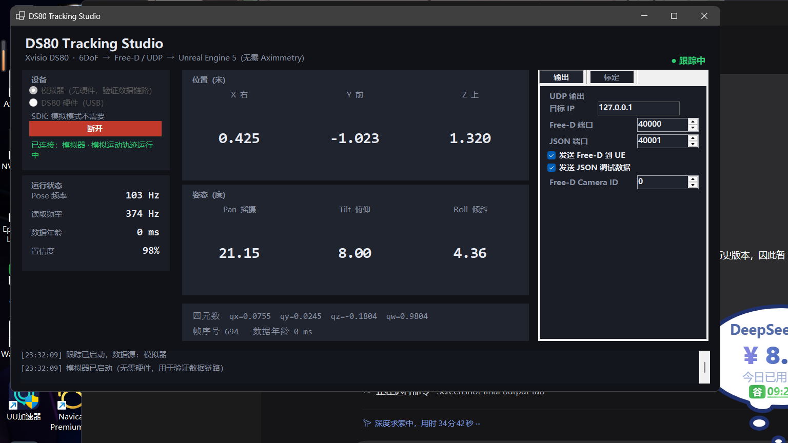

# DS80 Tracking Studio

把 **Xvisio SeerSense DS80 / S80** 双目 6DoF 模组变成 UE5 可直接使用的摄像机跟踪源。
不依赖 Aximmetry，不依赖 OptiTrack / Vive 基站。

```
┌──────────┐   USB-C   ┌─────────────────────┐   UDP   ┌──────────────────────────┐
│  DS80    │ ────────► │  DS80 Tracking Studio│ ──────► │  UE5 (Live Link FreeD)   │
│ 6DoF IMU │           │  标定 / 滤波 / 编码   │ 40000   │  CineCameraActor + 控制器 │
└──────────┘           └─────────────────────┘         └──────────────────────────┘
```

当前版本：**v0.4.1（ULENS 按 VIVE Mars 参考格式输出）**

- 新增 **Aximmetry 镜头 XML → UE `.ulens`**：把焦距、光心、K1/K2/K3 直接转成 UE Lens File，支持导入 Content Browser；实拍光学对齐需验证。
- 直接调用官方 **XVSDK C++ 接口**（`xv::Slam` 回调），不再经过会把位置取反的 CInterface 封装。
- 按 XVSDK 文档修正坐标系：设备 `X 右 / Y 下 / Z 前` → Free-D `X 右 / Y 前 / Z 上`。
- 支持多台设备按**序列号**选择（S80 / DS80），配置里记住上次使用的设备。
- 新增「诊断」页：并排显示 SDK 原始位姿与转换后的 Free-D 值，可直接和官方 `xvsdk-viewer` 对照。
- 500 Hz Pose、原点定位、UE Lens File 项目管理保持不变。

本次修订与导入报错说明见 [ULENS 兼容性验证](docs/06-ULENS兼容性验证.md)。

自绘 Live Link 插件（带置信度、丢失状态、镜头元数据）在第二阶段实现。



---

## 1. 现在就能跑（无需硬件）

```powershell
# 直接运行已编译版本
.\dist\DS80TrackingStudio\DS80Bridge.exe --sim --autostart
```

它会以模拟器产生 500 Hz 的摄像机运动，并同时向本机发送：

| 数据 | 地址 | 用途 |
|---|---|---|
| Free-D | `127.0.0.1:40000` | UE5 内置 **Live Link FreeD** 插件直接接收 |
| JSON | `127.0.0.1:40001` | 调试、录制、或接入自定义插件 |

用自带监视器验证：

```powershell
python tools\pose_monitor.py --seconds 5
```

期望输出：Free-D / JSON 平均接近 **500 Hz**，错误 0。Windows 调度会产生少量抖动。

本版使用高分辨率定时器和单调时钟调度：模拟器每 2 ms 产生一个 Pose，主机以 1000 Hz 轮询；设备以 2000 Hz 轮询，按 SDK 回调序号去重，以减少 USB 到达抖动造成的漏读。界面的 **Pose 频率**始终是实际新帧数，**读取频率**是轮询次数。

当前厂商 SDK 没有 SLAM Pose 频率设置函数；500 Hz 是目标，真实新帧频率由设备、SDK 和调度共同决定，不会重复旧帧来凑数。

---

## 2. 连接真实设备

### 2.1 装 SDK

官方 Windows 包（XVSDK 3.2.0，msvc2019-x64）：

```
https://download.xvisiotech.com/sdk-download/last_version/Select_Platform_Download/For%20windows/XVSDK-3.2.0-msvc2019-x64.exe
```

> 该站点 TLS 证书已过期，浏览器/curl 会报证书错误；下载后建议核对文件大小
> `40,317,259` 字节。本机已静默安装到 `C:\Program Files\xvsdk`。

安装后应存在：

```
C:\Program Files\xvsdk\bin\xvsdk.dll                      ← 官方 C++ SDK
C:\Program Files\xvsdk\include\xvsdk\xv-sdk.h             ← 头文件
C:\Program Files\xvsdk\bin\all_stream.exe                 ← 厂商验证工具
C:\Program Files\xvsdk\bin\xvsdk-viewer.exe               ← 官方 Viewer
```

本程序通过 `native\DS80NativeBridge.dll` 直接链接 `xvsdk.lib`，不依赖
`xvisio-CInterface-wrapper.dll`。该封装层会把位置 X/Y/Z 全部取反、返回毫米，
但不对四元数做相应变换，这正是旧版 6DoF 方向错误的来源之一。

### 2.2 装 USB 驱动（关键）

按官方 SDK Guide，Windows 需要给设备的 **VSC 接口**安装 libusb 驱动：

1. 插入设备（直连主板 USB 3.x，不要经过 Hub）。
2. 下载 [Zadig](https://zadig.akeo.ie/downloads/zadig-2.4.exe)。
3. `Options → List All Devices`，选中 Xvisio 的 **VSC interface**。
4. 目标驱动选 **libusb-win32**，点 `Install Driver`。

### 2.3 先验证厂商链路

```powershell
cd "C:\Program Files\xvsdk\bin"
.\all_stream.exe
```

能看到双目图像 + 6DoF 数据，说明硬件、驱动、固件都正常。
这一步不通过，后面的程序一定读不到数据。

### 2.4 再运行本程序

```powershell
.\dist\DS80TrackingStudio\DS80Bridge.exe
```

1. 选择 **Xvisio 硬件（USB / S80 / DS80）**，点 **刷新** 搜到设备。
2. 下拉框里选设备序列号（两台以上时必须选；程序会记住上次选择）。
3. 点 **连接**（初始化最长约 10 秒，界面不会卡死）。
4. 看到 Pose 频率持续更新、置信度 > 0 即成功；目标为 500 Hz，读取目标为 2000 Hz。
5. 打开右侧 **诊断** 页，与官方 `xvsdk-viewer` 的读数对照（见下节）。
6. 点 **定位原点 (R)**，默认把当前位置/航向设为零点；目标位置与姿态模式可在「项目校准」修改。
7. 镜头校准：**项目校准 → 镜头项目 → 导入 Aximmetry XML → .ulens**，把生成的 `.ulens` 拖进 UE Content Browser。

命令行探测（不打开界面）：

```powershell
dotnet run --project tests\DS80Bridge.SelfTest -c Release -- --list-devices
dotnet run --project tests\DS80Bridge.SelfTest -c Release -- --device            # 单台设备
dotnet run --project tests\DS80Bridge.SelfTest -c Release -- --device 2085...    # 指定序列号
```

### 2.5 6DoF 方向核对

XVSDK 文档定义的坐标系：

| | 轴 | 说明 |
|---|---|---|
| 设备/IMU | X 右、Y **下**、Z 前 | 相机主方向为 +Z |
| 世界 | X 右、Y **下**、Z 前 | 重力对齐，Z 为 SLAM 启动时的朝向 |
| Free-D | X 右、Y 前、Z 上 | 本程序输出 |

Bridge 用 `Rx(-90°)` 做换基（位置旋转、姿态 `R·q·R⁻¹`），因此：

| 真实动作 | 诊断页 / 主界面应有 |
|---|---|
| 向右摇摄 | Pan 增大 |
| 抬头 | Tilt 增大 |
| 向右倾斜 | Roll 增大 |
| 向右平移 | X 增大 |
| 向前推 | Y 增大 |
| 升高 | Z 增大 |

「诊断」页上方是 SDK 回调原始值（位置米、四元数 XYZW、欧拉角），下方是转换后的
Free-D 值。`SDK 欧拉` 使用 SDK 的 `rotationToPitchYawRoll`，与官方 Viewer 的显示口径一致。

如果方向相反：先确认「标定 → 设备坐标系」为 **XVSDK**，再检查是否装了旧版配置
（v0.3.0 首次启动会自动把旧的 `Y 上 / Z 后` 迁移为 XVSDK）。仍有单个轴反向时，
才使用「方向校正」勾选框。

---

## 3. 接入 UE5（零代码）

UE5 自带 **Live Link FreeD** 插件，本程序输出标准 Vinten Free-D D1 报文（29 字节）。

1. 编辑 → 插件：启用 **Live Link** 与 **Live Link FreeD**，重启编辑器。
2. 窗口 → Live Link → `Source → LiveLinkFreeD Source`：
   - IP：`127.0.0.1`
   - Port：`40000`
3. 出现 Subject **`Camera 0`**（编号来自程序里的 Free-D Camera ID）。
4. 场景中放一个 **Cine Camera Actor**，添加组件 **Live Link Controller**，
   Subject Representation 选 `Camera 0`。
5. 在设备前走动 / 转动，虚拟摄像机应同步。

详细的轴向核对与标定流程见 [docs/02-UE5-FreeD集成.md](docs/02-UE5-FreeD集成.md)。

---

## 4. 目录结构

```
DS80TrackingStudio/
├─ src/DS80Bridge/            WinForms 主程序（.NET 8，x64）
│  ├─ Core/
│  │  ├─ XvisioNative.cs      固定 C ABI 的 P/Invoke 绑定
│  │  ├─ XvisioPoseSource.cs  按序列号连接设备、读取 SDK 原始 Pose
│  │  ├─ SimulatorPoseSource.cs
│  │  ├─ TrackerPipeline.cs   XVSDK → Free-D 换算 / 原点 / 安装偏移 / 滤波
│  │  ├─ AximmetryLens.cs     Aximmetry XML → UE .ulens
│  │  ├─ PoseMath.cs          四元数与 Free-D 角度
│  │  ├─ FreeDEncoder.cs      29 字节 Free-D 编码 + 校验
│  │  ├─ UdpOutput.cs         Free-D + JSON 发送
│  │  ├─ PoseTiming.cs        高分辨率截止时间调度
│  │  ├─ TrackerEngine.cs     采样主循环（500 Hz Pose 目标，超采样读取）
│  │  ├─ OriginCalibration.cs 原点文件
│  │  ├─ LensProject.cs       UE Lens File 项目参数
│  │  └─ AppSettings.cs       配置持久化 + 旧配置迁移
│  ├─ MainForm.cs
│  └─ CalibrationForm.cs
├─ native/                    DS80NativeBridge.cpp（官方 C++ SDK → 固定 C ABI）
├─ tests/DS80Bridge.SelfTest/ 无硬件自检 + 设备探测
├─ tools/pose_monitor.py      UDP 监视器（Free-D 解码校验）
├─ docs/                      硬件 / UE / 协议 / 标定文档
└─ dist/                      发布产物
```

---

## 5. 已实现 / 未实现

**已实现并验证**

- 官方 XVSDK C++ 接口直连（`xv::getDevicesUntilTimeout` / `xv::Slam` 回调）
- 多设备按序列号选择，记住上次设备
- 6DoF 读取（米制位置、XYZW 四元数、SDK 欧拉角、置信度、时间戳）
- 坐标系换算：XVSDK `X 右 / Y 下 / Z 前` → Free-D `X 右 / Y 前 / Z 上`
- 原始数据诊断页（与官方 Viewer 对照）
- 原点定位（位置/航向或完整姿态、指定目标坐标、原点文件保存/加载）
- 镜头项目管理与 UE Lens File 初始化脚本导出（可编辑机型、画幅、焦距等；实拍求解在 UE 完成）
- **Aximmetry XML → UE `.ulens`**（焦距、光心、K1/K2/K3；UE 5.8.4 导入/导出参数往返验证，不代表实拍校准验收）
- Bridge / UE 安装补偿归属切换，避免重复 Nodal Offset
- 安装偏移（设备不在摄像机光心时的平移/旋转补偿）
- 可选低通滤波
- Free-D 编码（位置 1/64 mm、角度 1/32768°，校验和）
- JSON 输出（含置信度、数据年龄、四元数）
- UDP 发送与回环自检（`dotnet run --project tests/DS80Bridge.SelfTest`）
- 模拟器全链路验证（UE 可在无硬件时先调试）

**未实现（第二阶段）**

- 自绘 Live Link 插件（直接推送 `FLiveLinkCameraFrameData`，带跟踪状态）
- 录制 / 回放（CSV）
- CSLAM 地图保存 / 加载（长距离拍摄抗漂移）
- 镜头元数据（设备没有变焦/对焦编码器，需外接）
- 时间码同步（genlock / PTP）

---

## 6. 已知限制

- **漂移**：Mix / VIO 模式会累积误差；长镜头建议用 CSLAM 建图后锁定地图。
- **重定位跳变**：遮挡后恢复时坐标可能跳变，实拍前务必走一遍“遮挡恢复”测试。
- **世界系随启动重置**：SLAM 的 Z 轴取启动朝向；重启跟踪后需要重新定位原点。
- **单进程单设备**：一个 Bridge 进程管理一台设备；多机位用多进程 + 不同端口 / Camera ID。
- **UE 5.8**：内置 Live Link FreeD 在 5.4–5.7 均存在，5.8 未实测（本机未装 5.8）。
  若 5.8 移除该插件，用第二阶段的 JSON 插件替代。
- **旧原点文件**：坐标系与单位已变更，v0.2.x 保存的 `.ds80origin.json` 需要重新定位。

---

## 7. 构建

```powershell
native\build.cmd                                       # 先编 C++ 桥接（需要 VS x64 工具链）
dotnet build src\DS80Bridge\DS80Bridge.csproj -c Release -p:Platform=x64
dotnet run --project tests\DS80Bridge.SelfTest -c Release
# 五秒 500 Hz 模拟器双通道 UDP 实测（含报文、序号、丢包检查）
dotnet run --project tests\DS80Bridge.SelfTest -c Release -- --timing
powershell -ExecutionPolicy Bypass -File build.ps1     # 生成 dist/
```
