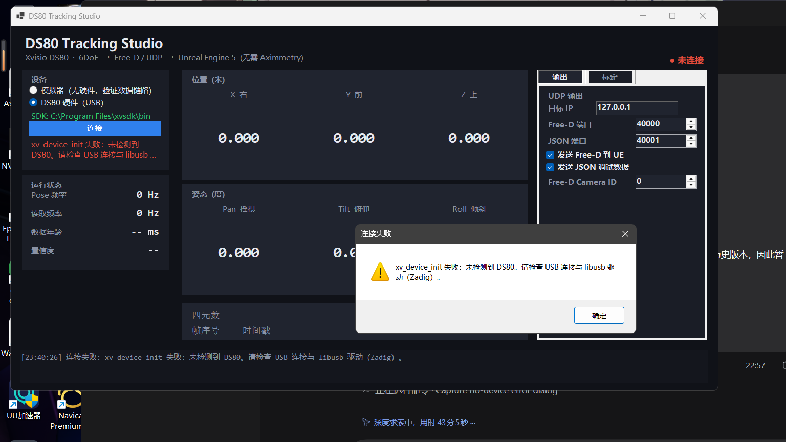

# 01 · 硬件与 SDK 准备

目标：让 Windows 11 正确识别 DS80，并能用厂商工具读到 6DoF。
这是第一阶段的第一道验收，**不通过就不用往下写代码**。

---

## 1. 连接与识别

1. 用**支持数据传输**的 USB-C 线连接 DS80。
2. 直连主板 USB 3.x 接口，不经过 Hub / 扩展坞。
3. `Win + X` → 设备管理器，展开：
   - 通用串行总线设备
   - 通用串行总线控制器
   - 相机
   - 其他设备（重点看有没有黄色感叹号）

### 判断标准

| 现象 | 结论 | 下一步 |
|---|---|---|
| 出现新设备，无黄色感叹号 | A · 识别正常 | 装 SDK + 驱动 |
| 出现新设备，有黄色感叹号 | B · 缺驱动 | 用 Zadig 装 libusb-win32 |
| 插入后完全没变化 | C · 线/口/供电问题 | 换线、换 USB3 口、确认设备供电 |
| 能看到设备但不确定 | D | 看硬件 ID 的 VID/PID，或问厂商 |

> 设备名不一定叫 DS80，可能是 `Xvisio`、`USB Device`、`VSC interface`。
> 以插入前后“新增了什么”为准。

---

## 2. 安装 XVSDK（Windows x64）

下载页（注意：站点证书已过期，浏览器会拦截）：

```
https://download.xvisiotech.com/sdk-download/last_version/Select_Platform_Download/For%20windows/
XVSDK-3.2.0-msvc2019-x64.exe     40,317,259 字节
XVSDK-Viewer-3.2.0-2-msvc2017-x64.exe
```

安装后目录：

```
C:\Program Files\xvsdk\
├─ bin\
│  ├─ all_stream.exe                 厂商验证工具（先跑它）
│  ├─ demo-api.exe                   官方 API 示例
│  ├─ xvsdk.dll / xvslam.dll         官方 C++ SDK（本程序直接链接）
│  ├─ libusb-1.0.dll
│  └─ python-wrapper\                ctypes 示例
├─ include\xvsdk\xv-sdk.h            C++ API
├─ lib\                              静态库（xvsdk.lib，native 桥接使用）
├─ samples\                          demo 源码
└─ doc\xvsdk\                        Doxygen 文档
```

> 本机已静默安装到此路径，`DS80Bridge.exe` 会自动找到它。
> 如果装到别处，设置环境变量 `XVSDK_BIN` 指向 `...\bin` 即可。
> 程序自带的 `DS80NativeBridge.dll` 由 `native\build.cmd` 生成，必须与 `DS80Bridge.exe` 放在同一目录。

---

## 3. 安装 libusb 驱动（最容易漏的一步）

官方 SDK Guide 明确写明 Windows 端需要用 Zadig 给 **VSC interface** 换驱动：

1. 插入 DS80。
2. 下载 <https://zadig.akeo.ie/downloads/zadig-2.4.exe>。
3. 打开 Zadig → `Options → List All Devices`。
4. 在列表里找到 DS80 / Xvisio 的 **VSC interface**。
5. 右侧驱动选择 **libusb-win32**（不是 WinUSB）。
6. 点 `Install Driver`，等待完成。
7. 设备管理器里该设备会移到「libusb-win32 devices」。

如果列表里看不到设备，先确认第 1 节的识别结果，并勾选 Zadig 的
`Options → List All Devices`。

---

## 4. 用厂商工具做“第一束光”

```powershell
cd "C:\Program Files\xvsdk\bin"
.\all_stream.exe
```

期望：弹出窗口显示双目鱼眼图像，控制台打印 pose / IMU 数据。
这一步能跑通，才说明 **硬件 + 驱动 + 固件 + SDK** 全链路正常。

也可以跑 API 示例：

```powershell
.\demo-api.exe
# 按提示输入 2（mixed 6dof）或 3（edge 6dof）
```

---

## 5. 本程序的设备探测

不打开界面，直接验证 SDK 与设备：

```powershell
dotnet run --project tests\DS80Bridge.SelfTest -c Release -- --device
```

正常输出示例：

```
== DS80 设备探测 ==
SDK 目录: C:\Program Files\xvsdk\bin
SDK 已加载: C:\Program Files\xvsdk\bin
xvsdk version: 3.2.0-20240905
libusb version: 1.0.26
连接结果: True（耗时 3200 ms）
DS80 已连接并启动 6DoF，用时 3200 ms
Pose: x=0.0123 y=1.4021 z=-0.0331 q=(0.0012,0.7070,0.0021,0.7072) conf=0.982
...
```

### 本机实测（2026-10-21，未插 DS80）

```
SDK 目录: C:\Program Files\xvsdk\bin
SDK 已加载: C:\Program Files\xvsdk\bin
xvsdk version: 3.2.0-20240905
libusb version: 1.0.26 (11724)
Usb hotplug not supported, using devices' list scanning (1 second loop).
连接结果: False（耗时 10052 ms）
xv_device_init 失败：未检测到 DS80。请检查 USB 连接与 libusb 驱动（Zadig）。
Timeout: no device found
```

结论：**SDK 调用链完全打通**，只差硬件。`xv_device_init()` 在无设备时会阻塞约 10 秒
（SDK 内部的扫描循环），所以程序把连接放到了后台线程，界面不会假死。

未插设备时，界面上的提示如下（连接按钮会先显示“连接中…”，约 10 秒后弹窗并回到未连接状态）：



---

## 6. 故障排查

| 现象 | 原因 | 处理 |
|---|---|---|
| `连接结果: False（耗时 10052 ms）` + `Timeout: no device found` | 没插设备 / 没装 libusb 驱动 / 线只有充电功能 | 先跑 `all_stream.exe` |
| `DllNotFoundException: DS80NativeBridge.dll` | 没编译 native 桥接，或没和 exe 放一起 | 在仓库根目录运行 `native\build.cmd`，或改用 `build.ps1` 生成的 dist |
| `SDK 返回无效 Pose（ABI / 数值检查失败）` | 桥接 DLL 与 C# 结构体版本不一致 | 重新运行 `native\build.cmd` 并重新构建发布包 |
| `BadImageFormatException` | 程序不是 x64 | 用发布的 x64 版本；不要用 AnyCPU |
| `all_stream.exe` 有图像但没有 pose | 固件/模式问题 | 升级固件；确认设备支持 6DoF 输出 |
| pose 置信度长期为 0 | 镜头被完全遮挡、纯白墙、暗光 | 增加纹理/光照；SLAM 需要特征点 |
| 设备管理器有感叹号 | 驱动未装 | Zadig → libusb-win32 |
| 插入后立刻断开 | 供电不足 / Hub | 换直连 USB3 口，用带供电的线 |

---

## 7. 下一步

SDK 与设备就绪后，回到 [README](../README.md) 第 2.4 节运行 `DS80Bridge.exe`，
然后按 [02-UE5-FreeD集成](02-UE5-FreeD集成.md) 把数据接进 UE5。
